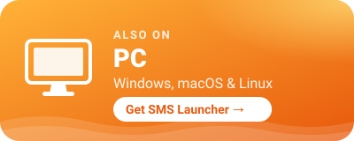
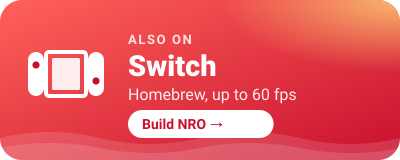
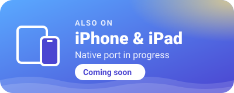
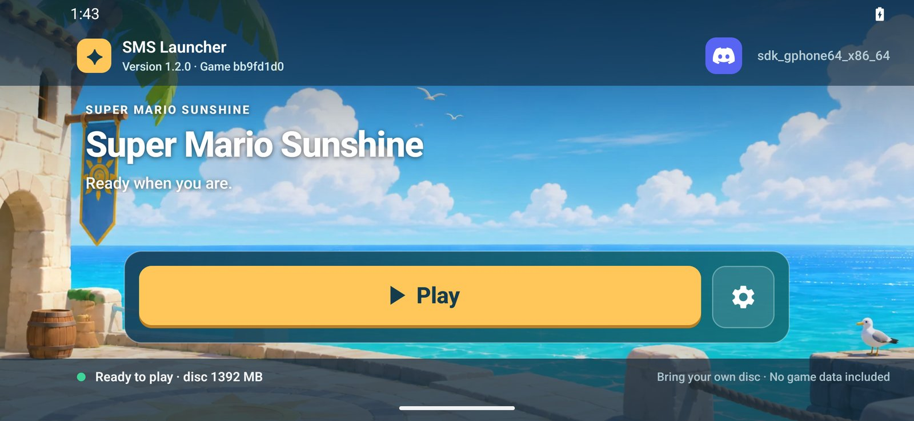
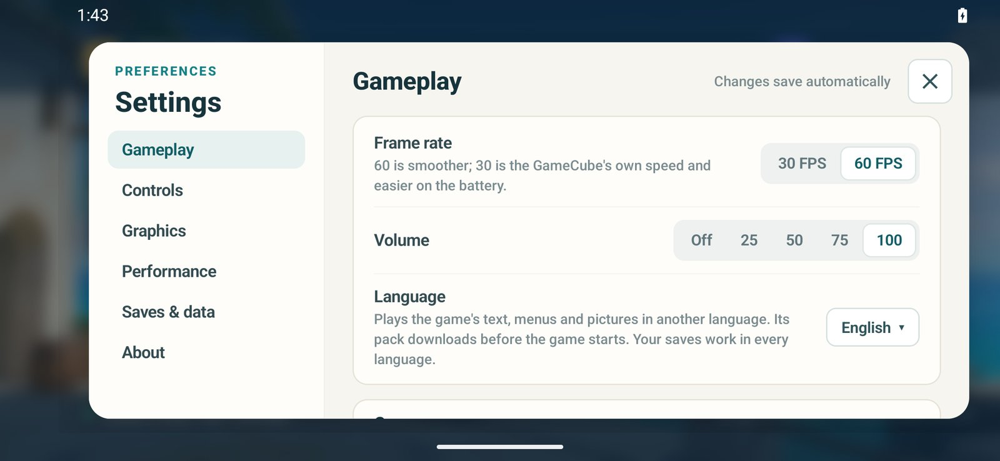

<p align="center">
  <a href="https://discord.gg/97sVPsbxsY"></a>
  <br>
  <a href="https://discord.gg/97sVPsbxsY"></a>
</p>

<p align="center">
  <a href="https://github.com/chasem-dev/sms-launcher"></a>
  <a href="https://github.com/chasem-dev/sms-switch"></a>
  <a href="https://github.com/chasem-dev/sms-iphone-ipad"></a>
</p>

# SMS Launcher for Android

A native Android launcher for the [Super Mario Sunshine PC port](https://github.com/chasem-dev/sms-pc-port).
The APK includes the compiled port and SDL, but no game data: you import a disc
image made from your own copy. It targets ARM64 Android 10 or newer, with
GLES 3.1 or newer, and a controller or the on-screen touch controls. AYN Thor
and similar modern Android handhelds are the intended hardware. On Windows,
macOS and Linux, use the desktop
[SMS Launcher](https://github.com/chasem-dev/sms-launcher) instead.

<p align="center">
  
  
</p>

## Download

APKs are published on this repository's
[Releases](https://github.com/chasem-dev/sms-android/releases) page: full
releases, starting with 1.0.0, and tester previews between them as
pre-releases. Each has two: `sms-android-<version>-arm64.apk` plays Super Mario
Sunshine, and `sms-android-eclipse-<version>-arm64.apk` (SMS Eclipse) plays
[Super Mario Eclipse](https://gamebanana.com/mods/536309). They install side
by side, each with its own disc and saves. Install over the previous release
or preview to keep your imported disc and saves. Previews 1 to
17 were published from the desktop launcher's repository as
`android-pr-107-v*` pre-releases; this repository's builds update them in place.
[CHANGELOG.md](CHANGELOG.md) lists what changed in each release and preview.

## Status

See [VALIDATION.txt](VALIDATION.txt) for build and emulator results. Plaza
gameplay is currently slow in the ARM64-translating emulator; handheld
performance has not been measured on AYN Thor. An S24 Ultra tester reports
near-60 FPS while recording but lower FPS during ordinary play. Performance
requests and faster-core placement did not help in their comparisons. Their
timing log identified an avoidable extra refresh wait in our background-work
fallback; preview 12 replaces it with a short cooperative turn. The tester
reports that build is much faster and supplies a sustained nominal-60 FPS
4:3 run, while widescreen still runs around 55–60 FPS. Preview 13 reduces
CPU work in widescreen layout;
its device FPS effect needs comparison. The two tester runs were not a
controlled matching-camera benchmark.

## Build

Most players should [download](#download) an APK instead. To build your own,
you need a computer running Linux, macOS or Windows (through WSL), about 8 GB
of free space, and an internet connection. You don't need Android Studio, and
you don't install the Android SDK yourself: the first `./build.sh` downloads
Google's Android SDK tools into `~/Android/Sdk`, then the SDK packages the
build needs (`platforms;android-35`, `build-tools;36.0.0`,
`ndk;28.2.13676358`, `cmake;3.22.1` and `platform-tools`). Those are Google's
SDK packages, not MSYS2 or Linux packages.

### 1. Install the basic tools

**Windows:** build in WSL, a Linux system inside Windows; MSYS2 and Git Bash
aren't supported. Open PowerShell as administrator and run `wsl --install`,
restart, then open **Ubuntu** from the Start menu and choose a user name and
password. Run every command below in that Ubuntu window, starting with the
Ubuntu ones.

**Ubuntu or Debian** (and WSL):

```sh
sudo apt update
sudo apt install openjdk-17-jdk python3 git curl unzip patch
```

**macOS** (untested): install the Xcode command line tools with
`xcode-select --install`, and a JDK 17 or newer.

### 2. Download the source

```sh
cd ~
git clone --recurse-submodules https://github.com/chasem-dev/sms-android.git
cd sms-android
```

On Windows, clone inside Ubuntu's home folder like this, not under `/mnt/c`:
building from the Windows drive is much slower.

### 3. Build

```sh
./build.sh
```

The first build downloads about 1.5 GB and takes a while; later builds only
redo what changed. It ends with the APK's location:

- Super Mario Sunshine: `app/build/outputs/apk/sunshine/debug/app-sunshine-debug.apk`
- `SMS_ECLIPSE=1 ./build.sh` builds the Super Mario Eclipse app instead:
  `app/build/outputs/apk/eclipse/debug/app-eclipse-debug.apk`

If the build runs out of memory, limit it with `./build.sh --max-workers=2`.

### 4. Install it on your phone

Copy the APK to your phone and open it there; Android asks you to allow
installing apps from your file manager or browser. On Windows, copy it out of
Ubuntu first, for example to your Downloads folder (with your Windows user
name):

```sh
cp app/build/outputs/apk/sunshine/debug/app-sunshine-debug.apk /mnt/c/Users/<you>/Downloads/
```

With USB debugging on, `~/Android/Sdk/platform-tools/adb install -r <apk>`
installs it directly.

Your build is signed with your own key, so it can't install over an APK from
the Releases page, or the other way round. Back up your save (Settings →
Saves & data) and uninstall the other one first; uninstalling removes the
imported disc too.

### Update

```sh
cd ~/sms-android
git pull
./build.sh
```

### Details for developers

`build.sh` uses the SDK in `ANDROID_HOME` (or `ANDROID_SDK_ROOT`), then the
one named by `local.properties`, then `~/Android/Sdk`
(`~/Library/Android/sdk` on macOS), installing whichever of the packages
above are missing; an Android Studio SDK works. Java comes from `JAVA_HOME`,
`PATH` or Android Studio. It downloads checksum-verified SDL 2.32.10,
initializes the port's decompilation submodule, and uses the checked-in
Gradle wrapper to build only `arm64-v8a`; extra arguments go to Gradle.
The game comes from the `sms-port` submodule, pinned to the
[sms-pc-port](https://github.com/chasem-dev/sms-pc-port) commit this launcher
builds; set `SMS_PORT_ROOT` to build a different port checkout. The Eclipse
build is the game with the Eclipse mods built in (the port's
`-DSMS_ECLIPSE=ON`, which fetches their sources at configure time; see the
port's `docs/ECLIPSE.md`), checked against the mods' declarations after
linking.

`tests/check-input-monitor.sh`, `tests/check-controller-mapping.sh`,
`tests/check-texture-pack.sh`, `tests/check-language-pack.sh` and
`tests/check-update-check.sh` run the input monitor's, controller mapping's,
texture pack installer's, language pack installer's and update check's unit
tests without the Android SDK, and `tests/check-vcdiff.sh` the Eclipse disc
patcher's.

## Releases

Merging a pull request into `main` publishes a release automatically, through
`.github/workflows/release.yml`, when `CHANGELOG.md` has lines under
`## Unreleased`:

1. It numbers the next preview of `smsAndroidVersion` (`0.2.0-preview.1`,
   `0.2.0-preview.2`, …) from the existing release tags.
2. It builds the release APKs, Sunshine's and Eclipse's, with `release.sh`,
   signed with the keystore in the `ANDROID_KEYSTORE_BASE64` repository secret.
3. It publishes a GitHub pre-release with the Unreleased lines as its notes,
   then commits those lines under the new preview's heading in `CHANGELOG.md`.

Pull requests with nothing under Unreleased (tests, CI, docs) publish nothing.
To start a new release line, raise `smsAndroidVersion` in `gradle.properties`;
previews then count from 1 again. Each version allows 99 previews. Pull
requests are built by `.github/workflows/build.yml`, which uploads the debug
APK as an artifact.

To publish a full release instead of the next preview, set
`smsAndroidFullRelease=true` and `smsAndroidVersion` to the release's number in
the pull request that should publish it. Its version code must be above every
preview testers have (major × 1000000 + minor × 10000 + patch × 100 + preview),
so a full release of a version that already has previews needs a higher number
(0.2.0's previews were followed by 1.0.0). The workflow publishes it as the
latest release, with the Unreleased lines and every preview's since the last
full release as its notes, then sets `smsAndroidFullRelease=false` and moves
`smsAndroidVersion` to the next patch, whose previews the following pushes
publish.

To move the game, check out the new commit in the submodule
(`git -C sms-port checkout <commit>`), commit it with a changelog line for
each change testers will notice, and merge.

`./release.sh` builds the same signed APKs locally into `dist/`. It refuses to
run with uncommitted changes, so the footer names clean source revisions. It
signs with `~/.android/debug.keystore` unless `SMS_ANDROID_KEYSTORE` (and
`SMS_ANDROID_KEYSTORE_PASS`, `SMS_ANDROID_KEY_ALIAS`) name another key, and
refuses to sign with a certificate other than the one previous previews used,
because Android won't install an update signed with a different key over an
existing install. Never commit or share the keystore.

## Build identification

Both landscape panels scroll independently, with fixed headings, a swipe hint
and persistent scrollbars when content overflows. The launcher keeps a two-line
footer visible while either panel scrolls.
It shows the launcher version, preview number, debug/release variant,
ARM64 architecture and the launcher/game source revisions actually built.
Tracked local edits add `-modified`; source archives without Git show `unknown`.
The same metadata is written to the game log at startup and survives log export.
The game revision is the `sms-port` commit that was built.

`smsAndroidVersion` in `gradle.properties` and the preview number set the
version name (`0.2.0-preview.1`) and version code (major × 1000000 +
minor × 10000 + patch × 100 + preview), so each new preview is an
identifiable update. Local builds use preview 0 and have no preview suffix.
Install over the previous preview to retain data. Export a save backup before
uninstalling; uninstalling also removes the imported disc.

## Use

Install the APK and open the landscape SMS Launcher. Its big yellow button
does the next step until the game is ready: first **Import disc image**. Pick a
US revision 0 Sunshine ISO or GCM using Android's document picker. Import
copies it into private app storage; allow enough free space for that copy.
The button then reads **Play**. The gear beside it (or Start on a controller)
opens Settings: Gameplay, Controls, Graphics, Performance, Saves & data and
About. Changes save as you make them. A controller's D-pad or stick moves
through the launcher, A selects and B goes back. The Discord button in the top
bar opens an invite to the Discord server.
**Language** under Gameplay plays the game in English (the default, the
disc's own text) or in any language pack the game's
`tools/mods/language-packs.json` lists: Deutsch, Español, Français, Italiano
and Polski. Choosing Play downloads the chosen language's pack (about 1 MB,
from the [HD texture extras](https://github.com/chasem-dev/sms-hd-texture-extras#language-packs)
releases), checks it against its MD5 and installs it in private app storage,
as the desktop SMS Launcher does. Saves work in every language. The Eclipse
app has no Language setting: Super Mario Eclipse plays in English.
Android doesn't let the launcher update itself, so it checks this
repository's GitHub releases when it opens (at most every six hours) and,
when a newer version is out, shows a **Get update** button in the top bar,
which opens the release page. A full release hears of full releases; a
preview also hears of newer previews, as the desktop launcher's Stable and
Beta channels do. The new APK installs over the old one, keeping the disc and
saves, because every release is signed with the same key.
**Picture sharpness** is the internal resolution: Original (1×, the
GameCube's 640×528, the default), Sharper (2×), Very sharp (3×) or
Sharpest (4×). Higher settings need more of the graphics chip.
**HD textures** defaults off. **Download HD textures** fetches the
[Super Mario Sunshine UHD Texture Pack](https://github.com/qashto/Super_Mario_Sunshine_UHD_Texture_Pack)
v2.1.1 (about 941 MB, from its authors' release page) and the port's
[HD texture extras](https://github.com/chasem-dev/sms-hd-texture-extras)
(about 61 MB), the releases the game's `tools/mods/get.py` pins. Each
download is checked against its MD5 and unpacked into private app storage
(about 3.1 GB installed; allow 5 GB free during setup, since the archive is
kept until it is unpacked). A stopped or dropped download continues where it
left off. The switch turns on once both are installed, and **Remove HD
textures** deletes them. GPUs that sample the pack's BC7 images, such as the
Adreno 750, get every image at full size: Delfino Plaza's take about 175 MiB.
Other GPUs get them decoded to RGBA, four times their size, so the launcher
halves those with more texels than 1024×1024 and caps texture memory at
1 GiB; in the emulator, whose GPU takes no BC7, Delfino Plaza then needs
about 560 MiB. Loading screens take longer while the pack's images are
prepared.
Connect a USB/Bluetooth controller or use the handheld's built-in gamepad.
**Touch screen controls** (off by default) draws a GameCube controller over
the game: both sticks are analog, the D-pad takes diagonals, and L and R press
fully. The game shows GameCube button prompts while it is on. The controls hide
while a real controller is used and come back when the screen is touched.
**Android performance hints** defaults on and lets supported devices adjust
CPU scheduling to the frame workload. It does not force clock speeds or
bypass thermal limits. Toggle it off to compare the same scene and settings,
then back on: saved choices carry over between updates, so a comparison left
off stays off. On a Snapdragon 8 Gen 3 phone, 0.2.0-preview.6 holds 60 FPS with
hints on or off; low clocks there came from the game stalling mid-frame on
the GPU, which Android read as idle time.
**Use performance CPU cores** defaults on (from 0.2.0-preview.7; players who
changed it keep their choice). It restricts the game's
frame-producing thread and optional renderer worker to a detected group of
big/prime cores. It uses the current thread's allowed CPU mask, prefers
complete scheduler-capacity metadata, and falls back to complete maximum
frequency metadata from one source. It never guesses from core numbering,
never restricts to one core, and leaves placement unchanged if a distinct
multi-core tier cannot be identified. Android still controls clock speeds
and thermal policy. This works independently of ADPF: compare it on/off
with performance hints, headroom and display matching off, restarting Play
between runs. Game logs report requested/effective core masks or the reason
for falling back. Testers found it smoother on older builds, and on
0.2.0-preview.6 still a little smoother than without it, so it is now the
default; switch it off to save battery or to compare.
**Request performance headroom** defaults off and asks ADPF to finish frame
work within 80% of the frame interval (about 13.35 ms at nominal 60 FPS),
leaving a margin for presentation and scheduling variation. It changes the
requested deadline, not game speed or reported measurements. Switch it off
to restore the v8 full-frame target. This is a tuning experiment, not a
confirmed fix for a manufacturer's clock policy. The S24 Ultra tester reported
v9 was slower, so both headroom and display matching are opt-in from v10.
Existing explicitly saved choices are preserved; turn these two switches off
when comparing with v8. Supported Android 15+
sessions explicitly disable power-efficiency preference, which is already
the platform default; that call alone does not imply a boost.
**Match display refresh to game FPS** defaults off and sends a Surface frame
rate hint on Android 11+. Android chooses the actual display refresh rate.
The game also reports interruptible gameplay while its activity is resumed
and no gameplay on pause using Android 13+ Game State. The selected Android
Game Mode is read on resume; the app cannot select Performance mode for you.
No game-mode configuration overrides the manufacturer's interventions.
**Log performance timings** defaults off. Enable it to export steady frame
and presentation timing, SDK pacing waits and main-thread CPU time without
recording or touching the screen during the sample. A current CPU frequency
sample is included when Android allows reading it; -1 means unavailable.
SDK pacing also reports background-handoff average/max wall time. These
logs include a GX breakdown for vertex decoding, draw submission, textures,
copies and peeks to help investigate the extra widescreen cost. These
timers add some overhead, and swap/wait times are CPU wall time,
not asynchronous GPU measurements. Startup logs include Game Mode, reported
Game State, battery saver, current display refresh and the frame rate request.
**Show performance overlay** reports the port's game/shown FPS, frame time,
game work, GX submission, presentation/swap and idle time. This helps
separate game timing from an external SurfaceFlinger FPS counter.
Android Back returns to the launcher. Each game session uses a fresh process.

Preview 15 fixes the unsafe memory fallback reported by an Adreno 740 tester.
If Android occupies the preferred game-arena address, the port reserves another
compatible range and updates both SDK and renderer address conversions. It
fails startup safely if no compatible range is available. The APK remains ARM64;
some legacy game data still stores addresses in 32-bit fields. Confirm a
successful title/save/stage load on the affected device before treating the
physical-device crash as resolved.

**Input test** under Settings → Controls opens
a landscape monitor without starting the game. It lists Android input devices
and USB adapters, and shows live key/button down/up events, scan codes,
modifiers, held keys and stick/trigger/hat axes. Bluetooth/wireless keyboards
use the same monitor. Both panels scroll; Refresh updates device inventory,
Clear resets the sample, and Done returns to the launcher. Controller Back/B
is captured for testing instead of closing the screen; system Back still exits.
Capture runs only while the test screen is active, with a bounded event history.
Export writes `sunshine-input.log` through the document picker, including
phone/build metadata, connected devices and the last 256 events.

For a generic adapter with no game input, open Input test, connect it, Refresh,
and press buttons/move sticks. Events here show what Android receives before
SDL mapping or game bindings. A USB adapter listed without an Android input
device suggests a different problem from a controller producing unmapped keys.
Export the sample to identify the device IDs and received codes before choosing
a mapping; the monitor itself does not fix or guess unknown controller layouts.

### Super Mario Eclipse

SMS Eclipse, the second APK, plays Super Mario Eclipse v1.1.0 by the Eclipse
Team. Choose **Import disc image** and pick the same US revision 0 Sunshine
ISO; it must be the unmodified 1:1 image (MD5
`0c6d2edae9fdf40dfc410ff1623e4119`), since Eclipse's patch is made for that
disc. Then choose **Download Eclipse**: the launcher downloads the
Eclipse Team's release (about 851 MB, from SMS Launcher's mirror of its
GameBanana release, or GameBanana itself), checks it against its MD5 and
patches your disc with it, giving the same `GMSE04` image Eclipse's own
patcher makes. Allow 3 GB of free space besides the imported disc; the
download and your Sunshine copy are deleted once the Eclipse disc is checked.
A stopped download continues where it left off. Unpacking the release needs
256 MB of the launcher's memory; on a device that grants less, make the image
with Eclipse's patcher on a computer and import that instead (it is checked
against MD5 `caa546309e0443f7b47632b040a250d7`). Its save backups hold the
`GMSE04_` card files.

Settings → Saves & data has your saves and the game log. **Back up your save**
writes a ZIP you can keep or move to the desktop port's
`card-a` folder. **Restore a backup** accepts a ZIP containing the desktop
port's `index.txt`, `super_mario_sunshine.dat` and
`super_mario_sunshine.stat`, at the root or beneath `card-a/`. Import keeps
the prior card in a private `saves/previous` folder. Use Export before
uninstalling: uninstalling deletes the disc, saves, settings and caches.
The import does not support Dolphin `.gci` or whole memory card images.

**Game log** uses the document picker to save diagnostic output.
Disc and save import need no broad storage permission, and gameplay is
offline. The Android launchers supply the base game, Super Mario Eclipse and
the optional HD textures.

## Emulator validation

On an x86 Linux host, the Android 35 Google APIs x86_64 image includes
`libndk_translation` and advertises `arm64-v8a`. Use the host GPU, KVM,
and a GLES 3.1/3.2-capable host driver. Software renderers that expose only
GLES 3.0 cannot run this renderer. Verify the emulator's ABI list and GPU
before installing; a successful x86 APK test would not validate this ARM64 APK.
The Android 30 image's older translator crashes on a valid ARM64 floating-point
conversion instruction emitted by the compiler; use the newer image.

```sh
adb shell getprop ro.product.cpu.abilist
adb shell getprop ro.dalvik.vm.native.bridge
adb shell dumpsys SurfaceFlinger
adb install -r app/build/outputs/apk/sunshine/debug/app-sunshine-debug.apk
```

Import a copy of your disc and exported save, then test the ordinary title
screen and file selection, loaded stage gameplay, movie playback, saving,
Back, and a second Play session. Keep screenshots and game logs with the
validation report. Emulator checks do not measure AYN Thor performance.

Debug APKs also include the native GX graphics self-test. With a disc imported,
start the launcher with the diagnostic intent and choose **Play**:

```sh
adb shell am force-stop dev.chasem.smslauncher
adb shell am start -W -n dev.chasem.smslauncher/.LauncherActivity \
  --ez gxSelftest true --esa testEnvironment SMS_GX_CHECK_ERRORS=1
adb shell run-as dev.chasem.smslauncher cat files/game/game.log
```

Wait for `66 passed, 0 failed` and `GX self-test returned 0` in the log
(`63 passed` if the GLES clipping extension is unavailable).
Export or copy that log before the next Play session replaces it. Force-stop
and reopen the launcher without the intent extras to resume ordinary gameplay.
The self-test library and diagnostic intent handling are omitted from release
builds. This test exercises the ARM64 renderer through a real Android SDL
surface, including depth peeks, pixel metrics, texture sampling and clipping.

For repeated debug gameplay checks, use `--esa testEnvironment
SMS_SKIP_MOVIES=1,SMS_OVERLAY=1` on the launcher intent instead of `gxSelftest`.
The movie flag skips non-looping prerecorded movies; native 3D camera sequences
still render. The overlay reports frame timing. These intent flags apply only
to debug APKs. Force-stop and reopen without extras to check ordinary playback.


Preview 16 fixes J3D texture-image and palette-load commands when Android
relocates the game's arena. The v15 tester log confirms compatible allocation
at 0x40800000, but the original address shortcut in those two writers encoded
incorrect texture pointers. Android now writes arena-relative addresses;
desktop behavior and v15 APK/release artifacts are preserved. Host byte-level
regression tests compile the real writers and show the previous relocation
failure followed by correct commands. Device image recovery must be retested.


Preview 17 adds a game-controller mapping for the reported legacy USB Gamepad
0810:0001. Its generic numbered keys reach SDL, but SDL's automatic Android
mapping requires named face buttons. The native fallback maps the matching
four-axis/numbered-button layout, preserving existing mappings. No new switch
is needed: connect it before Play or hotplug during the game. Physical button
assignments follow SDL's existing desktop profile and require tester checking;
use Input test to export key/axis identities if a button or camera axis is wrong.


Preview 0.2.0-preview.2 adds **Game settings → Controller configuration**.
Select a connected controller, tap Assign beside a GameCube control and press a button
or move the requested stick direction. L/R accept a button or calibrated
trigger. D-pad accepts keys, hats or an axis direction. Clear disables that
control; unchanged rows keep their automatic layout. Save applies the selected
controller on the next Play. Restore defaults then Save removes its overrides.
Both landscape panels scroll and the build footer stays visible. Capture is
restricted to the selected device and stops on focus loss/pause/disconnect.
Unsaved drafts survive Activity recreation; Done warns before discarding them.
Disconnected saved devices remain available for clearing/restoring settings.

Profiles persist by Android device descriptor, not the temporary input ID.
Play writes a private bounded profile file matched to SDL by VID/PID and the
same descriptor CRC used in SDL's Android GUID. Native mapping merges only
edited controls into the automatic mapping, supports previously unmapped
controllers and validates raw button/axis bounds. Configured known VID/PID
pairs use the Android input backend to match captured key/axis numbering;
controller rumble is unavailable in custom mode. Restore defaults restores
normal driver selection on the next Play. USB permissions are unchanged.
System Back still exits the game; a controller Back key explicitly assigned
to a game control is forwarded as controller input instead.

The screen covers every GameCube control. Under Triggers, L and R each have a
Full press row (a button gives the full press with the click; an analog trigger
keeps its whole travel) and a Soft press row: a light press without the click,
as when spraying FLUDD on the move, for controllers without analog triggers.
The Control stick and C-stick groups also have Up, Down, Left and Right rows,
so buttons can push either stick fully in one direction while the stick's own
axis keeps working. These extra rows start unassigned; Clear removes them.
Soft presses travel to the game as SDL paddle buttons, which Play binds to the
game's `L_SOFT`/`R_SOFT` controls through a private `SMS_BINDINGS` file.

Host checks cover Java Android-to-SDL button/axis rules, trigger calibration,
inversion, descriptor CRC and serialization, plus real SDL virtual-controller
profile matching/merging, malformed/out-of-range rejection, event conversion,
cleared controls, untouched defaults, calibrated triggers and inverted axes.
No Android container/emulator is run. The actual configuration UI, device
capture/save/reload and gameplay application need a physical tester.
